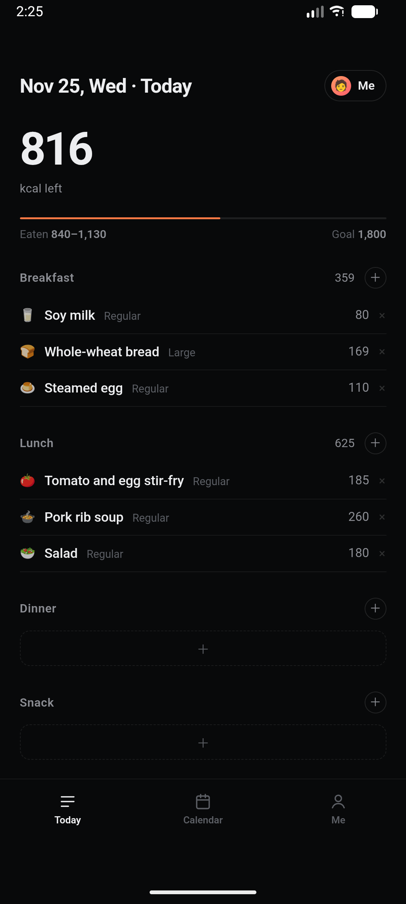
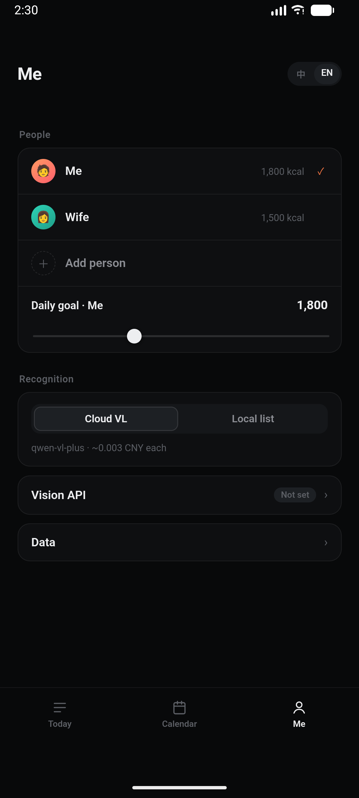

一餐一张照片，轻松看见每天的饮食节奏 🍽️📅 
One photo per meal. A clearer view of your daily food habits.

# 热量日历 Calories Today

热量日历是一款轻量的每日饮食记录应用。拍照识别食物后，可以调整份量并记录热量估算，也可以在日历中回看每天的饮食、热量趋势和体重变化。支持为不同成员设置各自的每日目标，并提供中英文界面。

Calories Today is a lightweight food journal for everyday use. Take a photo to identify a meal, adjust the portion, and log an estimated calorie range. Review meals, calorie trends, and weight changes in the calendar, with individual daily goals for each person.

[访问产品主页 · Visit the product page](https://mathsionyang.github.io/Calories-today/)

## 应用界面 · App Preview

<table>
  <tr>
    <td align="center"> <strong>今日饮食 · Today</strong></td>
    <td align="center"> <strong>拍照记录 · Photo log</strong></td>
    <td align="center"> <strong>日历与趋势 · Calendar</strong></td>
    <td align="center"> <strong>单日详情 · Day details</strong></td>
    <td align="center"> <strong>成员与目标 · People & goals</strong></td>
  </tr>
</table>

## 主要功能 · Features

- **拍照记录餐食 · Photo meal logging** — 从相机或相册添加食物，使用视觉模型辅助识别。Add a meal from your camera or photo library and use a vision model to help identify it.
- **灵活选择识别方式 · Flexible recognition** — 可配置兼容接口，也可使用本地食物列表手动记录。Configure a compatible API or log meals manually from the local food list.
- **按份量档位估算 · Portion-based estimates** — 通过少、正常、多调整份量，并以区间呈现热量估算。Choose a small, regular, or large portion and view calories as an estimated range.
- **日历回看 · Calendar history** — 查看每日记录、热量目标和近期变化。Review daily logs, calorie goals, and recent trends.
- **成员与目标 · People and goals** — 为家庭成员分别记录饮食并设置每日目标。Keep separate food logs and daily goals for each person.
- **中英文界面 · Chinese and English** — 根据偏好切换显示语言。Switch the interface language to suit your preference.

## 许可 · License

本项目以 MIT License 发布，详见 [LICENSE](LICENSE)。 
This project is released under the MIT License. See [LICENSE](LICENSE).

热量为估算值，仅供日常记录和趋势参考，不构成医疗建议。 
Calories are estimates for everyday logging and trend reference, not medical advice.
