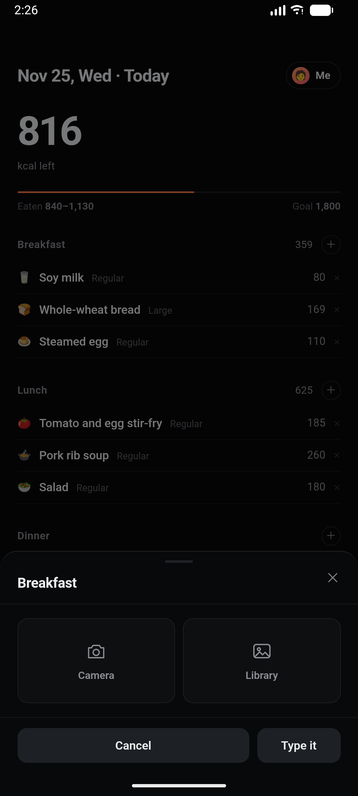
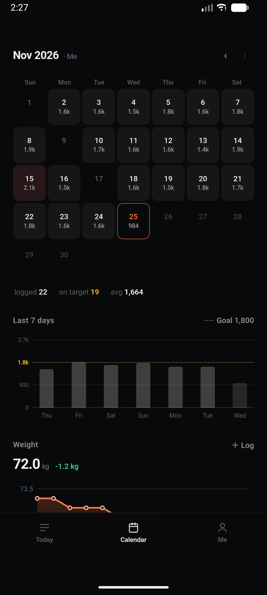
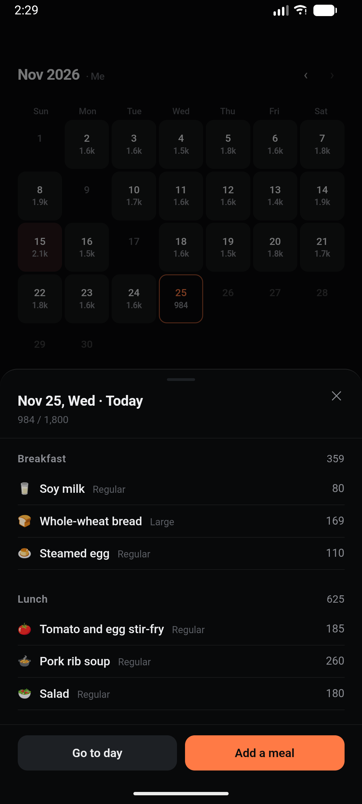

# 热量日历 Calories Today

用一张照片记下每一餐，在日历里看见自己的饮食节奏。

热量日历是一款轻量的每日饮食记录应用。拍照识别食物后，可以调整份量并记录热量估算，也可以在日历中回看每天的饮食、热量趋势和体重变化。支持为不同成员设置各自的每日目标，并提供中英文界面。

[访问产品主页](https://mathsionyang.github.io/Calories-today/)

## 应用界面

<table>
  <tr>
    <td align="center"> <strong>今日饮食</strong></td>
    <td align="center"> <strong>拍照记录</strong></td>
    <td align="center"> <strong>日历与趋势</strong></td>
    <td align="center"> <strong>单日详情</strong></td>
    <td align="center"> <strong>成员与目标</strong></td>
  </tr>
</table>

## 主要功能

- **拍照记录餐食**：从相机或相册添加食物，使用视觉模型辅助识别。
- **灵活选择识别方式**：可配置兼容接口，也可使用本地食物列表手动记录。
- **按份量档位估算**：通过少、正常、多调整份量，并以区间呈现热量估算。
- **日历回看**：查看每日记录、热量目标和近期变化。
- **成员与目标**：为家庭成员分别记录饮食并设置每日目标。
- **中英文界面**：根据偏好切换显示语言。

## 许可

本项目以 MIT License 发布，详见 [LICENSE](LICENSE)。

热量为估算值，仅供日常记录和趋势参考，不构成医疗建议。
